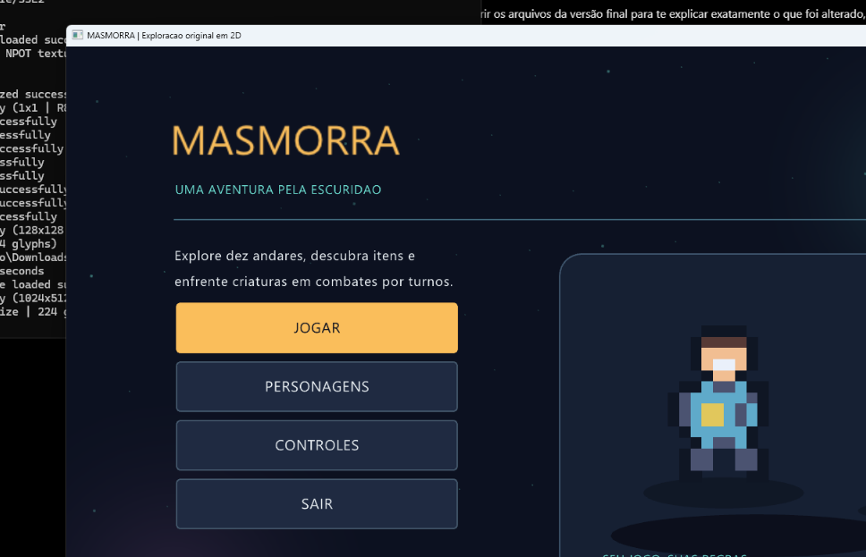

# MASMORRA

Roguelike em C++ inspirado no **Brogue**, feito para a disciplina de
Algoritmos e Programação II da UNIVALI (M3). São dez andares gerados
automaticamente, uma visão que revela o mapa conforme você anda, itens,
monstros e batalhas por turnos no estilo dos Pokémon antigos.



Grupo: Natã Rösler, Marcel Duarte e Murilo Bernz.

## Como jogar

Baixe o arquivo do seu sistema na página de **Releases** do repositório e
extraia. Não é preciso instalar nada.

| Sistema | Arquivo | Como abrir |
|---|---|---|
| Windows | `masmorra-windows.zip` | Dois cliques em `masmorra.exe`. Se aparecer "O Windows protegeu o computador", clique em **Mais informações → Executar assim mesmo**. O aviso aparece porque o programa não tem assinatura digital. |
| Linux | `masmorra-linux.tar.gz` | Dois cliques em `masmorra`, ou no terminal: `./masmorra` |
| Mac | `masmorra-mac.tar.gz` | No Terminal, dentro da pasta: `xattr -d com.apple.quarantine masmorra; ./masmorra` (o primeiro comando tira o bloqueio de "desenvolvedor não identificado"). |

### Comandos

| Ação | Teclas |
|---|---|
| Andar | setas, `W` `A` `S` `D`, `H` `J` `K` `L`, teclado numérico |
| Diagonais | `Y` `U` `B` `N`, Home / PgUp / End / PgDn |
| Batalhar | ande na direção do monstro |
| Mochila (usar / equipar) | `I` |
| Descansar | `Z`: +1 de vida por segundo (qualquer tecla para) |
| Histórico de mensagens | `M` |
| Ajuda | `?` |
| Pausa | `Esc` |
| **Na batalha** | setas escolhem, `Enter` confirma, `Esc` volta, `1`–`4` atalhos, ou clique com o mouse |

### Semente (seed)

Cada partida tem uma masmorra diferente, sorteada a partir de uma **semente**
(aparece na ajuda, tecla `?`). Para repetir uma masmorra, passe a semente ao
abrir o jogo pelo terminal: `masmorra.exe 1234` ou `./masmorra 1234`.

## Organização do código

A **lógica** do jogo fica toda em `src/`. Por cima dela existem duas formas de
desenhar a tela, e as duas usam exatamente a mesma lógica:

```
src/
├── aleatorio, batalha, gerador, itens, jogo,
│   mapa, monstros, visao (.cpp/.h)   lógica do jogo
├── tela.h, terminal.h                funções que cada versão de tela precisa ter
├── grafico/                          versão gráfica 2D (raylib), a principal
└── console/                          versão de terminal (texto colorido)
```

| Arquivo | O que faz |
|---|---|
| `src/jogo.h/.cpp` | Estado da partida (`struct Jogo`), andares, regras de cada ação |
| `src/mapa.h/.cpp` | Matriz do mapa, regra de movimento, BFS (mapa de distâncias) |
| `src/gerador.h/.cpp` | Geração dos andares (salas, cavernas, atalhos, escadas, tochas) |
| `src/visao.h/.cpp` | Campo de visão (shadowcasting) e iluminação |
| `src/monstros.h/.cpp` | Espécies, povoamento dos andares e inteligência dos monstros |
| `src/batalha.h/.cpp` | Batalha em turnos: golpes, elementos, status, dano, experiência |
| `src/itens.h/.cpp` | Itens: espalhar, sala do tesouro, pegar, usar e equipar |
| `src/aleatorio.h/.cpp` | Números aleatórios com semente (xorshift32) |
| `src/grafico/main.cpp` | Laço principal da versão gráfica, menu e pausa |
| `src/grafico/tela_grafica.cpp` | Desenho do mapa, painéis e batalha em 2D |
| `src/grafico/terminal_raylib.cpp` | Teclado, mouse e janela (raylib) |
| `src/grafico/menu_principal.cpp` | Menu principal e menu de pausa |
| `src/grafico/visual.cpp/.h` | Cores, fontes, painéis e barras |
| `src/grafico/sprites.h`, `extra_sprites.h` | Personagens em pixel art (16 x 16) |
| `src/console/` | A mesma coisa para o terminal: `main.cpp`, `tela.cpp`, `terminal.cpp` |

Mais detalhes:
- [docs/COMO_FUNCIONA.md](docs/COMO_FUNCIONA.md): como cada parte da lógica funciona (geração, visão, monstros, batalha, itens, equilíbrio).
- [docs/GUIA_DE_EDICAO.md](docs/GUIA_DE_EDICAO.md): como mudar desenhos, cores e textos da versão gráfica.

## Como compilar

A biblioteca gráfica (raylib 5.5) já vem junto, na pasta `externo/`. Não é
preciso baixar nada.

- **Windows**: precisa só do **g++ do MinGW-w64**. Dê dois cliques em
  `compilar_windows.bat`. Na primeira vez ele também compila a raylib (cerca de
  1 minuto); nas próximas, só o jogo. O jogo sai em `build\masmorra.exe` e abre
  sozinho no final.
  - Se o seu g++ for o MinGW **antigo** (o que vem com alguns cursos), o `.bat`
    compila só a versão de console e mostra como instalar o novo. Basta rodar
    uma vez no terminal: `winget install -e --id BrechtSanders.WinLibs.POSIX.UCRT`
    e depois o `.bat` de novo, que encontra o compilador novo sozinho.
- **Linux / Mac**: precisa de **CMake**. Rode `./compilar_linux_macos.sh`. No
  Linux, instale antes as bibliotecas da janela:
  `sudo apt install cmake libx11-dev libxrandr-dev libxinerama-dev libxcursor-dev libxi-dev libgl1-mesa-dev`

São gerados dois programas: `masmorra` (gráfico) e `masmorra_console`
(terminal). No Windows os dois são **estáticos**: o `.exe` roda em qualquer
computador, sem DLLs extras.

## Como publicar uma versão para download

O GitHub compila as três versões sozinho (`.github/workflows/release.yml`).
Basta criar uma tag e enviar:

```
git tag v0.2
git push origin v0.2
```

Em poucos minutos aparecem na página de **Releases** os arquivos
`masmorra-windows.zip`, `masmorra-linux.tar.gz` e `masmorra-mac.tar.gz`.
Para só testar a compilação sem publicar, use a aba **Actions → Compilar e
publicar → Run workflow**.

## Etapas

- [x] **1. Base**: movimento em 8 direções, tela sem piscar, multiplataforma
- [x] **2. Geração procedural**: salas, cavernas, atalhos, 10 andares, escadas, semente
- [x] **3. Visão**: campo de visão, iluminação, tochas, memória do mapa, câmera
- [x] **4. Monstros**: 9 espécies, estados, perseguição por BFS e rastro de cheiro
- [x] **4b. Batalha em turnos**: golpes com PP, elementos, status, níveis, 3 vidas, até 3 inimigos
- [x] **5. Itens**: poções, armas, escudos, cristais, pergaminhos, chave e sala do tesouro
- [x] **Versão gráfica 2D**: janela com raylib, pixel art, menu principal e pausa
- [ ] **6. Personagem**: criação (nome, elemento) e atributos distribuídos ao subir de nível
- [ ] **7. Mapa vivo**: armadilhas, obstáculos interativos, mapa que muda com jogador, monstros e NPCs
- [ ] **8. História**: abertura, NPCs, chefe final no andar 10 e tela de vitória
- [ ] **9. Pontuação**: tela de como jogar, itens e pontuação, pontuação na tela, ranking em arquivo

## Licença

MIT, veja [LICENSE](LICENSE).
