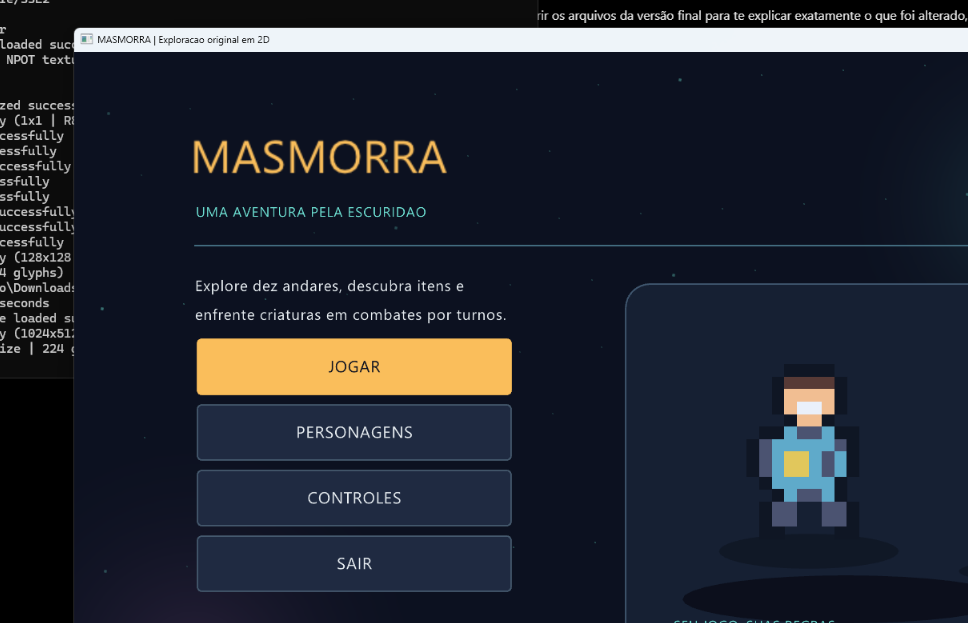

# MASMORRA 2D

Roguelike em C++ inspirado no Brogue, com exploração em dez andares, mapas gerados automaticamente, visão que se revela conforme o jogador anda, itens espalhados, monstros e batalhas por turnos. Esta versão adiciona menu e gráficos 2D com **raylib**, aproveitando a lógica do jogo original.



## Para jogar no Windows

Se você já compilou o projeto, execute `build/masmorra_2d.exe`. **Esta versão do código foi configurada para abrir apenas a janela gráfica, sem o console preto.** Recompile primeiro para gerar o novo executável.

Para compilar no seu Windows (CMake + MinGW/g++ instalados), abra um terminal nesta pasta e execute:

```powershell
cmake -S . -B build -G "MinGW Makefiles" -DCMAKE_C_COMPILER=gcc -DCMAKE_CXX_COMPILER=g++ -DCMAKE_BUILD_TYPE=Release
cmake --build build --parallel 4
.\build\masmorra_2d.exe
```

**Raylib 5.5:** o CMake tenta baixá-la automaticamente na primeira configuração. Se o download falhar por problema de certificado, copie a pasta de código-fonte `raylib-5.5` (com `raylib-5.5/src/raylib.h` e `raylib-5.5/CMakeLists.txt`) para esta pasta e repita os comandos.

Para criar um pacote para outros computadores Windows, execute `preparar_masmorra_portatil.bat` após compilar, ou `compilar_e_preparar_windows.bat` para fazer tudo. Veja [COMO_GERAR_EXE.md](COMO_GERAR_EXE.md).

## Controles

- Setas, WASD ou HJKL para andar.
- I ou botão Mochila para inventário.
- Z para descansar.
- M para histórico, ? para ajuda.
- Batalha: LUTAR, ITENS, STATUS, FUGIR (mouse, setas e Enter).
- Esc para pausar.

## Como funciona o código

| Arquivo | Função |
| --- | --- |
| `src/jogo.cpp` | Movimentação e progressão originais |
| `src/gerador.cpp` | Geração dos andares |
| `src/visao.cpp` | Áreas descobertas e iluminação |
| `src/itens.cpp` | Equipamentos, itens e inventário |
| `src/monstros.cpp` | Comportamento dos inimigos |
| `src/batalha.cpp` | Batalhas e golpes |
| `src/tela_grafica.cpp` | Mapa, combate e painéis 2D |
| `src/menu_principal.cpp` | Menu principal e pausa |
| `src/sprites.h`, `src/extra_sprites.h` | Bonequinhos em pixel art |
| `src/visual.cpp`, `src/visual.h` | Cores, textos e dimensões da tela |
| `src/terminal_raylib.cpp` | Mouse, teclado e janela gráfica |
| `original_console/` | Cópia dos códigos originais para comparação |

Leia [GUIA_DE_EDICAO.md](GUIA_DE_EDICAO.md) para aprender a modificar os desenhos e a interface.

## Linux e macOS

O projeto usa C++17, CMake e raylib. É necessário compilar um executável em cada sistema operacional. Com as dependências de raylib instaladas:

```bash
cmake -S . -B build -DCMAKE_BUILD_TYPE=Release
cmake --build build --parallel 4
./build/masmorra_2d
```

No Linux, podem ser necessárias bibliotecas de desenvolvimento OpenGL e X11. O executável `.exe` do Windows não roda nativamente no Linux ou no macOS.

## Publicação no GitHub

Para enviar os arquivos, veja [COMO_PUBLICAR_NO_GITHUB.md](COMO_PUBLICAR_NO_GITHUB.md). Para disponibilizar o `.exe` para download, use **GitHub Releases**.

## Origem, licença e testes

Adaptação gráfica baseada no código de Natã Rösler. O projeto original está licenciado sob a **licença MIT**, preservada no arquivo [LICENSE](LICENSE). A pasta `original_console` mantém os arquivos originais.

O código-fonte da versão gráfica já foi executado no Windows pelo usuário. A alteração mais recente no subsistema de janela, para não abrir o console, ainda precisa ser recompilada e validada no Windows. Não foi gerado um `.exe` neste ambiente.
